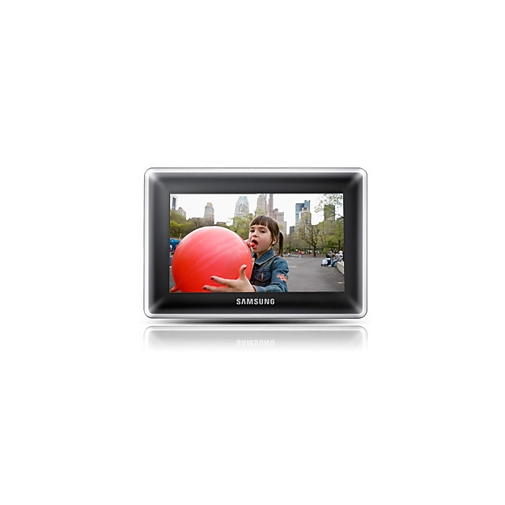
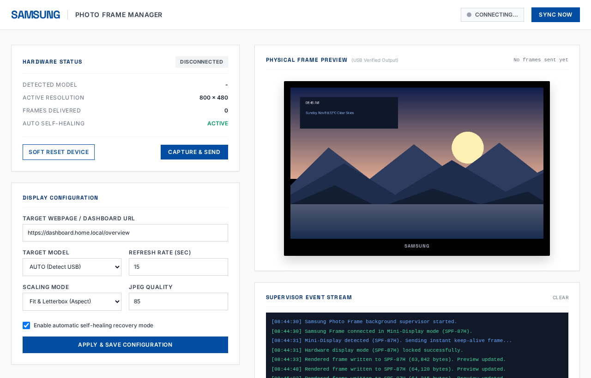

# Samsung Digital Photo Frame Manager & USB Service

<div align="center">
  
  <p><em>Modern Linux USB Controller, Web Scraper & Management Dashboard for Samsung Digital Photo Frames</em></p>
</div>

---

## Overview

This project provides an enterprise-ready daemon, Docker service, and web dashboard to repurpose legacy **Samsung Digital Photo Frames** (e.g., **SPF-87H** and **SPF-107H**) as real-time secondary displays over USB on modern Linux systems.

It continuously captures any user-configured webpage or web dashboard (Home Assistant, Grafana, custom status screens, clocks, weather) using headless Chromium, formats and letterboxes the image to the frame's exact native resolution, and streams it over USB Bulk endpoints.

---

## Web Management Dashboard

<div align="center">
  
  <p><em>Real-time web control center with live USB telemetry, preview, and configuration management.</em></p>
</div>

* **Live Status & Telemetry**: Instant feedback on device state (`DISPLAY_MODE`, `STORAGE_MODE`, `DISCONNECTED`), detected model, resolution, and frames delivered.
* **Display Configuration**: Set target dashboard/webpage URL, refresh interval (2s–3600s), scaling mode (`Fit & Letterbox`, `Fit Width`, `Cover & Crop`, `Exact Stretch`), and JPEG compression quality.
* **Hardware-Verified Preview**: Displays the rendered output image only after verified acknowledgment of delivery over the physical USB endpoint.
* **Supervisor Event Stream**: Real-time WebSocket log stream with ring buffer retention.

---

## Technical Hardware & Protocol Specifications

Samsung photo frames do not expose a standard HDMI, DisplayPort, or USB DisplayLink interface. Instead, they use a proprietary Samsung bulk endpoint protocol originally reverse-engineered by Grace Woo (MIT Media Lab) and modified by Joonas Lehthtinen (Gekkio):

### 1. Hardware Identification & Modes

* **Vendor ID**: Samsung Electronics `0x04E8`
* **Supported Models**:
  * **Samsung SPF-87H**: 800 × 480 native resolution (Storage PID: `0x2033`, Mini-Display PID: `0x2034`)
  * **Samsung SPF-107H**: 1024 × 600 native resolution (Storage PID: `0x2027`, Mini-Display PID: `0x2028`)

### 2. State Transitions & Mode Switching
When plugged in or powered on, the frame's internal firmware defaults to Mass Storage mode or prompts the user.

> [!TIP]
> **Recommended Hardware Setup**: When connecting the device or selecting a mode on the frame's physical display menu, choose **MASS STORAGE mode** and let the service automatically issue the control switch into **MINI MONITOR / DISPLAY mode**. Mode switching over USB might not always succeed on the very first attempt; if needed, simply retry or let the supervisor auto-heal.

* **Storage to Display Mode Switch**:
  To programmatically switch the frame without touching physical buttons, a standard USB device control transfer is sent:
  ```python
  dev.ctrl_transfer(CTRL_TYPE_STANDARD | CTRL_IN | CTRL_RECIPIENT_DEVICE, 0x06, 0xFE, 0xFE, 254)
  ```
  The device disconnects immediately from the USB bus and re-enumerates as product ID `0x2034` (or `0x2028`).
* **Display Mode Initialization & Keep-Alive Handshake**:
  Once in display mode, a vendor control message is sent to prevent the photo frame firmware from timing out or exiting display mode:
  ```python
  # Request vendor command 0x04; expected response is byte [0x03]
  dev.ctrl_transfer(CTRL_TYPE_VENDOR | CTRL_IN | CTRL_RECIPIENT_DEVICE, 0x04, 0x00, 0x00, 1)
  ```

### 3. Binary Framing Protocol & Bulk Writes
Images must be JPEG format, calibrated to the exact resolution of the frame.
* **12-byte Binary Header**:
  Every JPEG frame transmitted to the device must be prefixed with:
  ```
  [0..3]  Magic Bytes:      \xa5\x5a\x09\x04
  [4..7]  Image Length:     4-byte little-endian unsigned integer (len(jpeg_bytes))
  [8..11] Command Marker:   \x46\x00\x00\x00
  ```
* **Chunking & Buffer Alignment**:
  * Total payload (`header + raw_jpeg_bytes`) is transferred in **128 KB (0x20000)** buffers.
  * If the final chunk is smaller than 128 KB, it **must be zero-padded (`\x00`)** to exactly 128 KB.
  * Transferred in **16 KB (0x4000)** sub-chunks to Bulk Endpoint `0x02`.
* **Verified Preview Behavior**:
  The web UI live preview strictly reflects the image buffer **only after receipt of the bulk write acknowledgment** from the hardware (or mock driver).

---

## Log Retention & Supervisor Event Stream

* **Retention Policy**: To prevent unbounded memory growth and avoid clogging logs during long-running 24/7 dashboard deployments:
  * **In-Memory Ring Buffer**: The Python supervisor retains strictly the **latest 100 log entries** in memory (`pop(0)` when exceeded).
  * **Browser DOM Pruning**: The Web UI console automatically prunes the oldest DOM elements, capping visible log elements at **100 entries**.
  * **Initial Connection Catch-Up**: Newly connected browser WebSocket clients receive the last **30 recent events** on connection, followed by real-time streams.

---

## Docker Runtime & Usage

The application is containerized using Docker and Docker Compose with full USB passthrough support.

### Running with Docker Compose (Default via `start.sh`)

Simply run:
```bash
./start.sh
```
* **Default behavior**: Builds and runs the Docker container, mounting `config.json` for persistent settings and `/dev/bus/usb` with `privileged: true` for direct hardware communication. If no physical frame is detected, it automatically falls back to mock simulation mode.

### Docker Commands & Flags

```bash
# Run containerized with simulated hardware (test UI and self-healing)
./start.sh --mock

# Run on a custom port
./start.sh --port 8085

# Rebuild container image
./start.sh --build

# Gracefully stop running containers
./start.sh --down

# Run natively on the host system without Docker
./start.sh --native
```

### Direct Docker Compose Usage

```bash
# Start container in detached mode
docker compose -f docker/docker-compose.yml up -d

# View container logs
docker compose -f docker/docker-compose.yml logs -f

# Stop container
docker compose -f docker/docker-compose.yml down
```

---

## Rootless USB Configuration (Host Setup)

To allow the container or native service to access the USB device without `root` permission errors:

```bash
sudo cp 99-samsung-photoframe.rules /etc/udev/rules.d/
sudo udevadm control --reload-rules && sudo udevadm trigger
```

Or execute the automated setup script:
```bash
./setup.sh
```

---

## Running Automated Tests

```bash
python3 -m unittest discover -s service/tests
```
